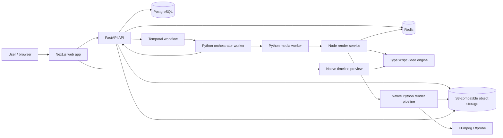
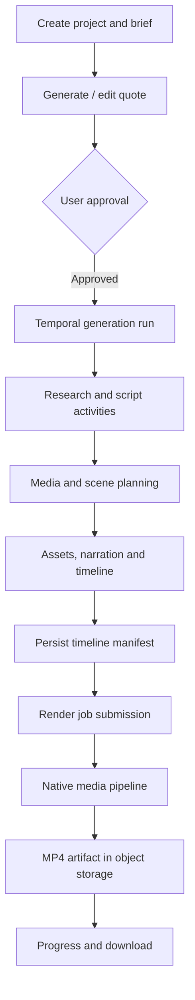
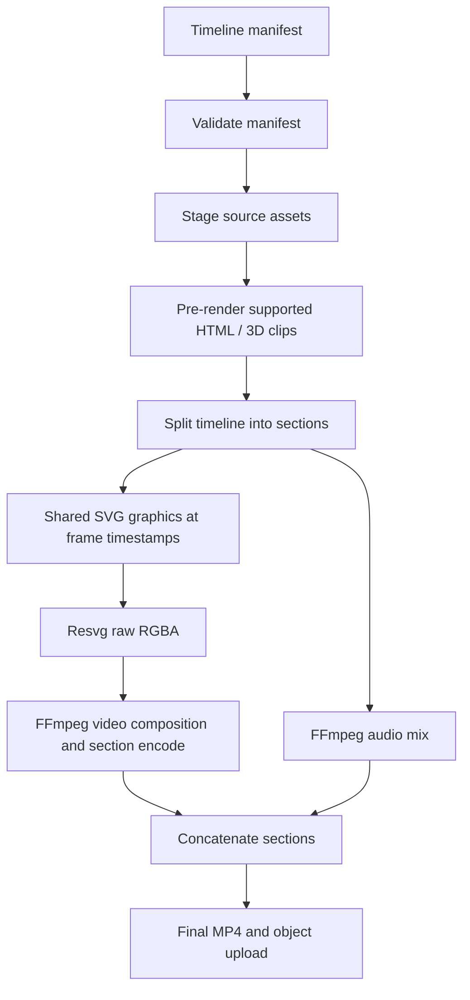
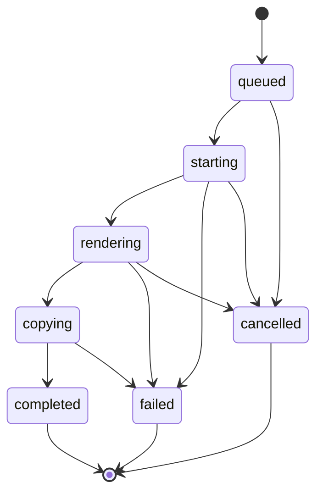

# Skyclip system architecture

**Status:** Source-derived overview; static inspection only.

## System overview

The repository includes code for these services and local Compose definitions. This diagram describes the observed architecture, not a claim that every service is always enabled or deployed identically in production.

## Core services

| Component | Source directory | Responsibility |
|---|---|---|
| Frontend | `apps/web` | Next.js application and editor UI |
| API | `apps/api` | FastAPI routes, authentication, projects, timelines and render coordination |
| Workflow worker | `workers/orchestrator` | Temporal worker and generation activities |
| Media worker | `workers/media` | Asset staging, media rendering, audio processing and export |
| Render service | `render-service` | Native render HTTP API, render job store and worker lifecycle |
| Video engine | `packages/video-engine` | Shared deterministic timing, SVG graphics, captions, templates and scene evaluation |
| Shared domain | `packages/shared-types`, `packages/timeline-schema` | Type and manifest contracts |
| Local infrastructure | `infrastructure/docker-compose.yml` | Postgres, Redis, MinIO, Temporal and application services |

## Video-generation workflow

The detailed activities are implemented across `apps/api/app/services`, `workers/orchestrator/src/activities`, `workers/orchestrator/src/workflows`, and `workers/media/src`. Provider availability and configured feature flags can affect individual generation activities.

## Rendering pipeline

See [RENDERING_ENGINE.md](./RENDERING_ENGINE.md). At a high level:

## Job lifecycle

The render worker persists job records when Redis is configured, uses leases and heartbeats to protect ownership, retries within configured limits, and can recover active jobs after process restart. The precise state transitions also depend on the store implementation; see `render-service/src/jobs/job-store.ts` and `render-worker.ts`.

## Data and infrastructure

- PostgreSQL stores API domain entities through SQLAlchemy models and Alembic migrations.
- Redis supports render-service job persistence and shared capacity coordination when configured; the API also uses Redis.
- S3-compatible storage stores source media and render artifacts.
- Temporal coordinates asynchronous generation activities.
- Local development uses MinIO as the S3-compatible service.

The README notes that some product/platform migrations and auth/credit integrations are incomplete. Do not interpret the presence of a config variable or ADR as proof that a planned migration is finished.

## Error handling and observability

- API routes translate service errors to HTTP responses and use liveness/readiness endpoints.
- Render jobs expose progress and terminal state; worker logs use structured logging.
- Render workers bound retries and runtime, support cancellation and verify output frame counts for some paths.
- Temporal activity and workflow retries are configured separately from render worker retries.
- Operational alerting, production SLOs and end-to-end trace coverage need deployment-level validation.

## Key implementation references

- `apps/api/app/main.py`, `apps/api/app/api/router.py`
- `apps/api/app/services/generation_service.py`, `render_service.py`
- `workers/orchestrator/src/workflows/video_generation.py`
- `workers/media/src/render/native_pipeline.py`
- `render-service/src/api/routes.ts`, `render-service/src/jobs/render-worker.ts`
- `packages/video-engine/src/index.ts`
