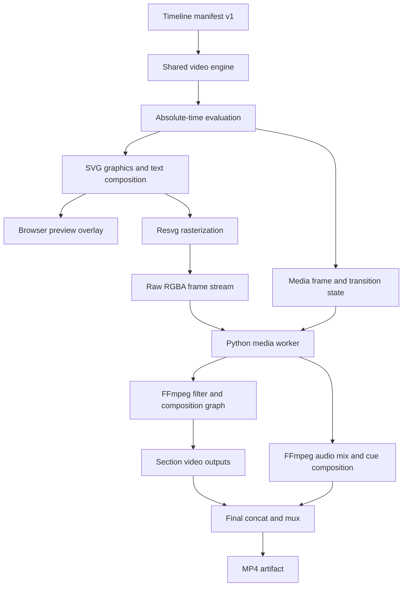

# Skyclip rendering engine

**Status:** Documentation based on source inspection at `main` commit `838db1a0de352c59887ce9b4774a0b751b5d8b7f`. Commands and runtime behavior still need an execution pass before being treated as release verification.

## Summary

Skyclip contains an owned, deterministic timeline and graphics engine. It evaluates authored scene state at explicit timestamps and uses shared composition logic for editor preview and export. It is **not** a standalone video codec or a replacement for FFmpeg.

The implementation is best described as:

> A custom timeline, motion-graphics and scene-composition engine, integrated with FFmpeg for media decoding, filtering, transitions, audio processing, encoding and muxing.

## High-level rendering architecture



## Owned rendering logic

| Capability | Source | Observed responsibility |
|---|---|---|
| Timeline timing | `packages/video-engine/src/timing.ts` | Half-open clip windows, duration and frame-time mapping |
| Media preview evaluation | `packages/video-engine/src/media.ts` | Evaluate visible media and transition state at a timestamp |
| Keyframes and animation | `packages/video-engine/src/animation.ts` | Pure interpolation of transforms, opacity, easing and loop motion |
| Clip effects | `packages/video-engine/src/effects.ts` | Deterministic local-time visual effect parameters |
| Text layout | `packages/video-engine/src/text-layout.ts` | Escaping, font selection and text layout |
| Graphic composition | `packages/video-engine/src/graphics.ts` | SVG scene output for timeline graphics and captions |
| Declarative scenes | `packages/video-engine/src/scenes.ts` | Data-only layers, sampled channels, reveal and shapes |
| Documentary templates | `packages/video-engine/src/templates.ts` | SVG layout/template rendering and media-slot geometry |
| Audio cue plan | `packages/video-engine/src/audio.ts` | Absolute-time scene/transition sound cue planning |
| Export rasterization | `render-service/src/native/render-graphics.ts` | Render SVG frames using Resvg and bundled font files |
| HTML template capture | `render-service/src/native/render-html.ts` | Chromium/Playwright frame capture for supported HTML/GSAP template scenes |
| Three.js scene capture | `render-service/src/native/render-three.ts` | Isolated browser WebGL scene rendering; WebCodecs or raw RGBA pipe |
| Media composition | `workers/media/src/render/native_pipeline.py` | Segment inputs, overlays, transitions, audio mix, encode and final mux |
| Render jobs | `render-service/src/jobs/render-worker.ts` | Queue, leases, progress, bounded retries, cancellation and restart recovery |

## Rendering pipeline

1. The API accepts a render request after project/run ownership and object-key checks in `apps/api/app/api/routes/render.py`.
2. The API client sends the manifest to `render-service`.
3. The render service validates request shape, creates/claims a job and runs the Python media CLI.
4. The Python worker validates the timeline manifest and stages media assets.
5. HTML motion clips and Three.js clips are pre-rendered when their respective data is present; their baked outputs are then treated as media sources.
6. The worker derives timeline sections, including black/background gaps, and composes each section with base video, b-roll, transitions and graphic frames.
7. The shared TypeScript engine creates SVG graphics at explicit frame timestamps. Resvg rasterizes to raw RGBA, piped into FFmpeg.
8. FFmpeg applies media/transition filters and creates section encodes. It separately mixes narration, music, SFX, original unmuted media audio and generated sound cues.
9. The worker concatenates encoded sections, muxes audio and uploads the MP4 artifact to S3-compatible storage.
10. The render service records completion and returns a result URL.

## What FFmpeg does

FFmpeg remains a core dependency. It handles:
- Source media decoding and frame extraction.
- Scaling, cropping, fit modes, transforms, effects and transition filters.
- Combining video, b-roll and rasterized graphics.
- Audio trimming, volume, fades, delays, ducking, mixing and limiting.
- H.264 encoding (NVENC when a real capability probe succeeds, otherwise libx264) and AAC audio encoding.
- Section concatenation, final audio/video mux and media probing through ffprobe.

Skyclip does not implement its own H.264/AAC codec stack.

## Other external components

- **Resvg:** SVG-to-pixel rasterization in the graphics export path.
- **Chromium/Playwright:** captures supported trusted HTML/GSAP and Three.js scenes at controlled timestamps.
- **Three.js:** renders the declarative 3D scene path.
- **WebCodecs:** optional scene-frame H.264 encoding where supported.
- **Redis:** durable render job state, lease/capacity coordination and recovery when configured.
- **S3-compatible storage:** source assets and exported artifacts.

## Limitations and verification

- GPU encoding is not equivalent to GPU composition. SVG rasterization, FFmpeg filters/composition and audio processing remain CPU-intensive.
- No zero-copy end-to-end GPU pipeline is documented or established.
- The generic SVG declarative runtime does not execute arbitrary uploaded HTML/JavaScript templates. The separate Chromium template path has its own validation and isolation requirements.
- A successful type check does not prove visual fidelity. Compare browser preview and decoded export frames for representative assets.
- Do not publish speed claims without hardware/configuration and cold/warm benchmark details.

## Local verification commands

From repository root, after installing dependencies:

```bash
pnpm --filter @hanuman/video-engine test
pnpm --filter @hanuman/video-engine typecheck
pnpm --filter @hanuman/render-service test
pnpm --filter @hanuman/render-service typecheck
```

Python suites require Python 3.12+, uv dependencies and FFmpeg/ffprobe:

```bash
cd workers/media
uv sync --group dev
uv run pytest
```

The commands above are based on package scripts and worker metadata. They were not executed during this audit.
